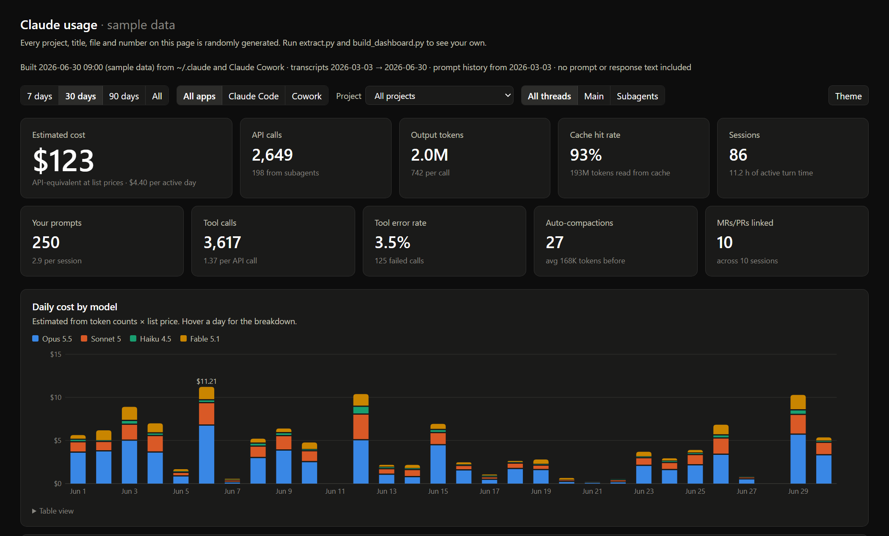

# claude-usage

**Covers both Claude Code and Claude Cowork.** Extract usage metadata from your local Claude Code data (`~/.claude`) and Claude Cowork sessions (the Claude desktop app's agent mode), and view it in one self-contained HTML dashboard. Filter by app, or compare them side by side.

Most usage tools only read Claude Code's `~/.claude` folder. Cowork keeps its sessions elsewhere (see [Claude Cowork](#claude-cowork)), and this tool reads both.

**[Live demo](https://codeasice.github.io/claude-usage/sample/dashboard_sample.html)** (randomly generated sample data)

[](https://codeasice.github.io/claude-usage/sample/dashboard_sample.html)

Records tokens, estimated cost, models, tools, latency, errors, subagents, compactions and activity timing. **Prompt and response text is never extracted.**

Python 3.10+ and the standard library are all you need: no dependencies, no network calls.

## Usage

```
python extract.py                    # ~/.claude -> out/usage.sqlite + out/csv/*.csv
python build_dashboard.py --open     # -> out/dashboard.html
python build_artifact.py             # -> out/artifact.html, ready to publish as a claude.ai Artifact
```

`skill/claude-usage-report.skill` packages these scripts as a shareable skill. It contains no data; each person who runs it reads their own.

`extract.py --no-titles` omits auto-generated session titles. `--no-cowork` skips Cowork; `--cowork-dir PATH` points at a non-default Cowork folder.

Everything is written to `out/`, which is gitignored. Treat it as personal data.

## What's in the dashboard

- Filters: date range, app (Claude Code / Cowork), project, main thread vs subagents, light/dark
- Headline numbers: estimated cost, API calls, output tokens, cache hit rate, sessions, prompts, tool calls, tool error rate, compactions
- Daily cost by model; cost by token type; main thread vs subagent cost
- Weekday x hour heatmaps of your prompts and of Claude's API calls
- Top tools, MCP servers and shell programs, with error rate and latency
- Context size per call; weekly prompt history
- Sortable tables of sessions, most-touched files, skills and subagent types
- Cowork turns: recorded vs estimated cost, turn duration, time to first token, permission denials, scheduled vs interactive, rate-limit events

Every chart has a table view.

## Claude Cowork

Cowork (the Claude desktop app's agent mode) doesn't write to `~/.claude`. Its sessions live in `%APPDATA%\Claude\local-agent-mode-sessions` on Windows and `~/Library/Application Support/Claude/local-agent-mode-sessions` on macOS. Each session there has:

- Claude Code-format transcripts (`.claude/projects/**.jsonl`), parsed the same way and tagged with `source = cowork`
- `audit.jsonl`, the agent's event log. Only `result` records (one per finished turn: duration, time to first token, cost, denials) and `rate_limit_event` records are read, into the `cowork_turns` and `rate_limit_events` tables. Message and result text are skipped.
- A sibling `local_<id>.json` per session. Only an allowlist of fields is read (title, created/last-active time, selected folder, scheduled or interactive). The account email, opening prompt and system prompt in that file are ignored.

A session's project is the first folder you picked for it, or "Cowork: scheduled" / "Cowork: no folder". Typed Cowork prompts carry no origin tag, so a non-subagent prompt that isn't a tool result or harness message counts as yours.

## Notes

- **Cost is an API-equivalent estimate** (token counts x list price, from `PRICES` in `extract.py`), not a bill. The cost Claude Code stores itself only covers the last process of a resumed session, so it is not used. Cowork does log a per-turn cost, which the dashboard shows next to the estimate as "recorded".
- Claude Code prunes old transcripts locally, so rerun `extract.py` regularly if you want long-term history. Prompt history (`history.jsonl`) usually goes back further.
- Update `PRICES` in `extract.py` when model pricing changes.
